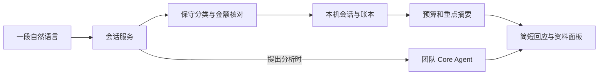

# 对话工作空间改造说明

日期：2026-10-20。目标：用户只需与一个助手对话，把长句里的生活、收入、投资打算和优惠需求整理好；后台承担分类、持久化、预算计算和模型请求。

## 仓库与来源核验

| 对象 | 核验结果 | 本次处理 |
| --- | --- | --- |
| `jinyihan77-create/finance-lab-demo` | main 为 `6ed9ee5`，10 月 12 日改造版 | 同仓库创建 `codex/conversation-backend` 分支 |
| `lixjanus526-art/finance-lab-ui-preview` | preview 为 `57e0a6b`，10 月 20 日版本 | 完整保留到 `upstream-preview/`，80 个文件逐一校验 |
| `D:\黑客松大赛冲刺版` 的本地随手记 | 已有可用的保守规则解析器 | 复用解析逻辑，接入新会话与持久化服务 |
| 原任务台和投资预览 | 仍需要表单和技术字段 | 保存原版入口，主入口改成对话与可展开资料 |

原改造目录出现了其他并行编辑，因此本次在 `D:\finance-lab-conversation` 隔离完成，没有覆盖那个目录里的修改。这里是同一个远程仓库的独立工作目录。

## 《设计需求单》

| 用户表达 | 落地要求 | 验收方式 |
| --- | --- | --- |
| “界面复杂、各种操作难受” | 一个主要输入框；首屏最多三个提示；不展示流程 DAG、JSON、调试字段和参数表单 | 首屏与手机截图；唯一主要输入入口 |
| “类似 GPT Work” | 左侧会话，中央对话，右侧结果按需展开；手机先显示聊天 | 1440 / 390 / 320 宽度实测 |
| “一大段话自动整理” | 同一请求拆出收入、消费、订阅、计划、优惠需求；输出短回应与折叠明细 | 混合消息测试，检查金额和币种 |
| “记住重点，按时间更新” | 投资与大额事项保留时间和来源；可查看和忘记摘要 | 刷新持久化、忘记与删除独立验证 |
| “用户只跟一个 AI 交互” | 缺失预算和金额在对话里逐项追问；纠错不跳表单 | 多轮对话与记录原位修改 |
| “舒服、透明” | 简短反馈，明确已记/计划/待核对；可以导出账本 | CSV、计划未成交、外币未折算检查 |
| “生活与投资冲突要提醒” | 用确定性账本计算余量；资料不足时问一句；模型分析只给复核意见 | 负余量与失败场景测试 |

沿用已有的深色、暖橙和细边框视觉体系。正式确认和交易执行不在当前对话服务权限内。

## 《设计规范单》

| 项目 | 本次参数 |
| --- | --- |
| 画布 | `#0b0a09` |
| 导航 / 面板 | `#141210` / `#12100e` |
| 输入框 | `#191613`，边框 `#68513e`，聚焦 `#c09169` |
| 主操作 | 现有暖橙 `#ed7627` |
| 主文 / 次文 | `#f8f3eb` / `#cfc4b5` |
| 字体 | 中文系统无衬线；正文 15–16px，行高 1.75–1.85；手机输入 16px |
| 对话宽度 | 最大 760px；侧栏 232px，结果栏 360px |
| 圆角 | 输入 18px；按钮 8px；结果摘要 12px |
| 间距 | 4 / 8 / 12 / 16 / 24 / 32px |
| 触控 | 按钮与交互入口最小高度 44px |
| 动效 | 180ms，`cubic-bezier(.4,0,.2,1)`；减少动态效果时关闭 |
| 响应式 | 950px 以下资料抽屉；700px 以下导航抽屉；320px 宽度无横向溢出 |
| 无障碍 | 可见焦点、输入标签、状态提示、Esc 关闭、抽屉焦点循环、方向键切换资料标签 |

## 交互与开源参考

仅借鉴公开交互，不复制第三方应用的源码、品牌资产或私有模型能力。

- [ChatGPT Work 官方入门](https://learn.chatgpt.com/training/walkthroughs/getting-started)：围绕一段任务描述展开工作，逐步补上下文和结果。本次采用对话主入口和可检查结果。
- [Open WebUI 的聊天组件](https://github.com/open-webui/open-webui/blob/main/src/lib/components/chat/Chat.svelte) 与[聊天文档](https://docs.openwebui.com/features/chat-conversations/)：会话是统一工作入口。本次采用历史会话恢复、单一输入框与状态反馈。
- [LibreChat Artifacts](https://www.librechat.ai/docs/features/artifacts) 和[开源仓库](https://github.com/danny-avila/LibreChat)：对话中的结果可在独立视图查看。本次使用按需展开的账本、投资和记忆面板。

这些是界面组织方式的参考，不表示本项目拥有它们的全部工具、语音、多模型或账户能力。

## 后端如何承接

浏览器负责输入、显示、抽屉与草稿。`assistant/service.py` 负责追问、纠错、请求幂等、比例计划联动和统计；`journal_parser.py` 保守提取财务事实；`storage.py` 以 SQLite 保存按会话隔离的资料；`core_client.py` 对接已有团队模型。新入口不调用旧页面的演示 fallback。

数据接口只有读取状态、发送消息、删除/忘记记录、导出表格。原始用户话语留在本地聊天记录；结构化财务摘要不保存对象姓名和情绪标签。模型复核只接收当前分析问题、相关财务摘要与偏好，不自动上传全部历史聊天。

投资与大额事项优先留下可追溯摘要，并按发生时间排序。当前“大额”只采用界面提示阈值（人民币 1000 元、美元 200 元），不是正式风险评级。没有把情绪、吃饭水平或消费金额转化为财富等级。

人民币余量 = 月初现金 + 已记收入 + 投资卖出回款 − 生活/订阅支出 − 投资流出 − 待执行流出计划 − 剩余必要开支 − 应急预留。已发生和待执行分开；待核对不计入；美元单列。资料缺失时显示未知，而非默认零。

## 交付范围

这是可运行的本地对话改造版与仓库分支，未合并 main、未公网部署。旧静态部署不能直接承载 SQLite 服务；未来上线需要会话认证、服务端数据库与域名部署环境，再完成多用户验收。

财务提取目前是规则系统；模型已接通用于分析，但泛化的长句理解、完整语义记忆、语音、券平台、券商持仓、定时行情、正式风险回调与交易审批闭环仍属于后续能力。此分支不声称已训练新的核心 Agent。
